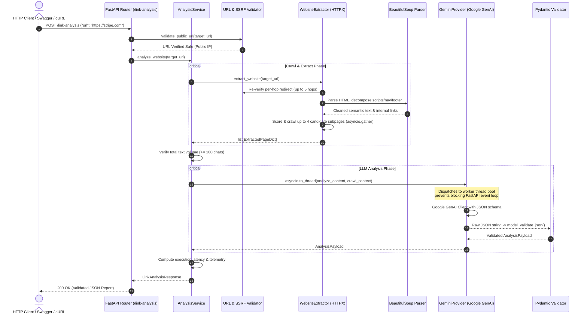

# LinkScope AI System Architecture & Engineering Design

This document details the architectural principles, component responsibilities, concurrency patterns, and security guarantees of **LinkScope AI**.

---

## 1. System Context & Data Flow

LinkScope AI processes link analysis requests through a non-blocking asynchronous pipeline:



---

## 2. Core Architectural Pillars

### A. Non-Blocking Async Concurrency
- **Asynchronous I/O**: Network requests to target websites use `httpx.AsyncClient` with connection pooling (`httpx.Limits(max_keepalive_connections=5, max_connections=10)`).
- **Concurrent Subpage Crawling**: Relevant subpages (`/about`, `/services`, etc.) are resolved concurrently via `asyncio.gather(*tasks, return_exceptions=True)`.
- **Worker Thread Offloading**: The official `google-genai` Python SDK performs synchronous blocking socket I/O. Calling synchronous SDK methods directly in an `async def` FastAPI route would monopolize the single-threaded event loop. We use `asyncio.to_thread(provider.analyze, context)`, delegating inference execution to Python's internal threadpool while keeping the main loop completely available for incoming traffic.

### B. Defense-in-Depth SSRF & Web Crawler Security
- **Protocol Whitelist**: Strict enforcement of `http://` and `https://` only.
- **Port Whitelist**: Restricts destination ports to standard web ports (`80`, `443`, `8080`, `8443`), rejecting internal administration ports (e.g. `22`, `3306`, `6379`, `27017`).
- **Loopback & Private Range Rejection**: All target hostnames are resolved via `socket.getaddrinfo()`. All resolved addresses are checked against `ipaddress.ip_address.is_global`.
- **Cloud Metadata Interception**: Explicitly drops requests to AWS/GCP/Azure link-local metadata endpoints (`169.254.169.254`, `metadata.google.internal`).
- **Iterative Redirect Validation**: Rather than delegating redirects to HTTPX (`follow_redirects=True`), the crawler operates with `follow_redirects=False`. Every single HTTP `3xx` redirect hop is intercepted, inspected, and passed through `validate_public_url()` before the next request is initiated. Redirect loops and chains exceeding 5 hops are rejected.
- **Memory Bomb / Stream Protection**: Responses are read via streaming chunks (`aiter_bytes()`) capped at 2MB (`MAX_RESPONSE_BYTES`). If a remote host attempts a decompression bomb or multi-gigabyte ISO stream, the connection is instantly severed.

---

## 3. Error Classification Taxonomy

The system defines domain-specific exceptions in `app/exceptions.py` mapped to RFC 9110 HTTP status codes in `app/routes/analysis.py`:

| Domain Exception | HTTP Status Code | Scenario Triggered | Client Message Character |
| :--- | :--- | :--- | :--- |
| `InvalidUrlError` | **400 Bad Request** | Malformed URL, missing host, forbidden port, private IP, localhost, SSRF target | Clear client-side correction instructions |
| `ContentTooShortError` | **422 Unprocessable Content** | Clean text extracted is < 100 characters (SPA/JS-only shell, empty page) | Informs client of JS dependency or empty site |
| `WebsiteInaccessibleError` | **502 Bad Gateway** | Target site timed out (>15s), connection refused, returned 403 (Cloudflare) or 404 | Specific upstream failure cause identified |
| `LLMConfigError` | **503 Service Unavailable** | Missing or default placeholder `GEMINI_API_KEY` | Instructions to supply valid key in `.env` |
| `LLMServiceError` | **502 Bad Gateway** | Gemini quota exceeded (429), provider timeout, invalid JSON response | Upstream AI generation failure notice |
| `Exception` (Unhandled) | **500 Internal Server Error** | Unexpected internal python exception | Generic safe message (stack traces masked) |

---

## 4. Modular Provider Pattern

The LLM layer is decoupled through an abstract provider pattern:

```python
class BaseLLMProvider(ABC):
    @abstractmethod
    def analyze(self, site_context: dict) -> AnalysisPayload:
        pass
```

LinkScope AI implements concrete production providers:
1. **`GeminiProvider`**: Native schema enforcement (`response_schema=AnalysisPayload`) with Google GenAI SDK (`gemini-2.0-flash`).
2. **`GroqProvider`**: Ultra-high-speed inference on Groq LPUs (`openai/gpt-oss-20b`), achieving end-to-end analysis latencies under 4 seconds while strictly conforming to token-efficient JSON skeletons.

---

## 5. Visual Interactive Demo Presentation Layer

While the core application strictly adheres to the Python backend specification, LinkScope AI includes a self-contained, zero-dependency presentation dashboard served at `GET /demo` (and saved in `demo.html`).

- **Architecture**: Single-page static HTML/JavaScript client with Tailwind CSS via CDN.
- **Interactivity**: Submits `POST /link-analysis` directly to the FastAPI server, providing live latency monitoring, preset targets, structured cards for the 5 analysis sections, and an expandable raw JSON inspector.
- **Safety**: Fully decoupled from API contracts (`/`, `/health`, and `/link-analysis`), ensuring zero degradation of test suites or backend isolation.
